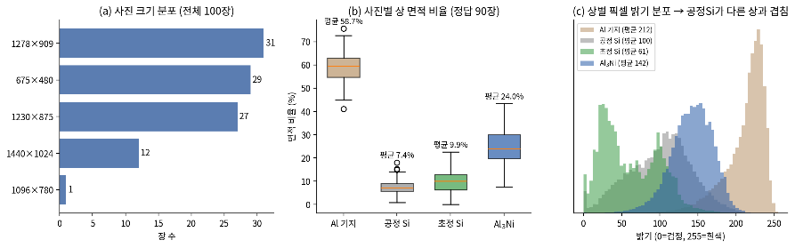
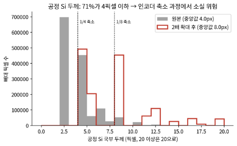
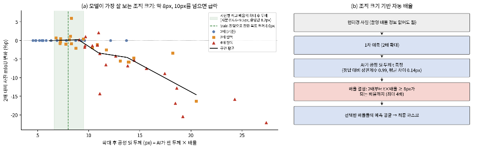
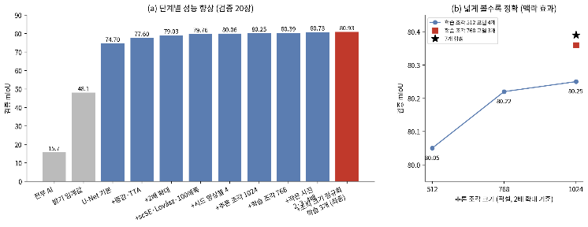
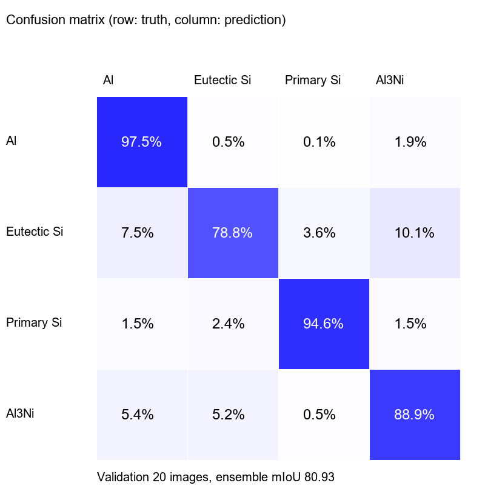
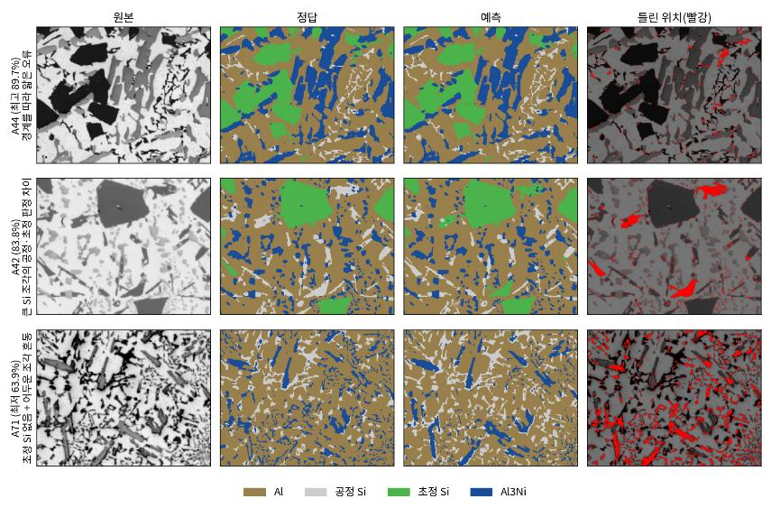
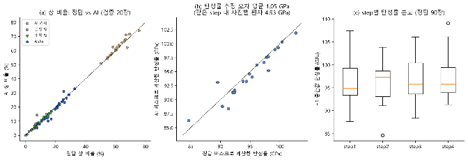
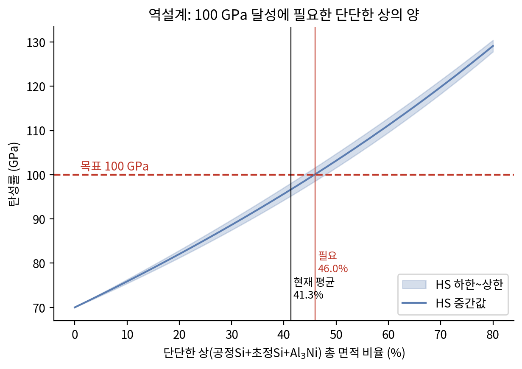

# 고탄성 Al-Si-Ni 합금 광학현미경 이미지 4상 분할

> **2026 KoMaP AI 경진대회** 출품작 · 팀 보들이의 여정
> 현미경 사진에서 합금의 상(Al · 공정 Si · 초정 Si · Al₃Ni)을 픽셀 단위로 나누고, 그 결과로 **합금 탄성률을 추정·역설계**한 프로젝트

| 검증 mIoU | 밝기 기준 대비 | AI vs 정답 탄성률 차이 | 100 GPa 달성 조건 |
|:---:|:---:|:---:|:---:|
| **80.93%** | **+32.8%p** | **평균 1.05 GPa** | **경질상 약 46%** |

---

## 한 줄 요약

공정 Si가 **두께 4픽셀짜리 가는 조직**이라 모델 인코더를 거치면 형태 정보가 거의 사라진다는 점을 데이터로 확인했고, **"조직 두께가 약 8픽셀이 되도록 사진을 확대한다"**는 재료 관점의 정규화로 성능을 끌어올렸습니다. 이어서 분할 결과를 Hashin–Shtrikman 복합재 모델에 연결해 탄성률을 추정하고, 100 GPa 달성에 필요한 상 분율을 계산했습니다.

## 문제

고탄성 Al-Si-Ni 주조합금의 탄성률은 Al 기지(약 70 GPa)보다 단단한 **Si(약 160 GPa)와 Al₃Ni(약 143 GPa)의 분율**에 좌우됩니다. 따라서 현미경 사진에서 각 상을 정확히 나누는 것이 물성 예측의 출발점입니다.

- 데이터: 광학현미경 흑백 사진 train 70 / valid 20 / test 10장, 사진 크기 5종(675×480 ~ 1440×1024)
- 어려운 점: 상별 밝기 분포가 크게 겹쳐 **밝기 임계값만으로는 mIoU 48.1%** (공정 Si IoU 17.4%)



## 핵심 아이디어: 사진 크기가 아니라 "조직 크기"로 맞춘다

**1. 진단** — 정답 마스크에서 공정 Si의 뼈대를 뽑아 국부 두께를 재보니 중앙값 4픽셀, 71.4%가 4픽셀 이하였습니다. U-Net 인코더는 첫 단계에서 사진을 1/4로 줄이므로 이 조직은 1픽셀 이하로 뭉개집니다.



**2. 확대** — 사진을 2배 확대해 공정 Si 두께를 약 8픽셀로 확보 → 같은 모델에서 77.8% → 79.03%, 공정 Si가 가장 크게 개선

**3. 최적 두께 확인** — 검증 사진을 2·3·4배로 각각 예측해 보니, 사진별 최고 성능 배율에서의 조직 두께가 중앙값 8.2픽셀로 수렴했고 10픽셀을 넘으면 오히려 성능이 떨어졌습니다.



**4. 자동 배율** — AI가 1차 예측에서 공정 Si 두께를 직접 재고(정답 두께와 상관계수 0.99), 그에 맞춰 배율을 정합니다. **촬영 배율 정보 없이도 동작**하므로 다른 현미경·촬영 환경으로 확장하기 유리합니다.

## 모델

- U-Net + ResNet34(ImageNet 사전학습) + scSE 주의 모듈
- 손실: Cross-Entropy + Lovász-Softmax / AdamW 3e-4, cosine, AMP, 100~150 에폭
- 추론: 1024 타일(겹침 평균) + 8방향 TTA
- 앙상블: 기본 2배 확대 모델 7개 + 조직 두께 정규화 모델 3개 = 10개 확률 평균
- 후처리: 초정 Si 예측 면적 0.5% 미만이면 오검출로 보고 제거 (train 통계 기반 기준)

### 성능이 오른 과정

| 단계 | 검증 mIoU |
|---|:---:|
| 밝기 임계값 (딥러닝 이전) | 48.1 |
| 기준 모델 (U-Net + ResNet34) | 78.91 |
| + scSE, CE·Lovász, 100 에폭 | 79.76 |
| + 시드 앙상블 4개 | 80.06 |
| + 추론 타일 1,024 | 80.25 |
| + 학습 조각 768 모델 3개 | 80.39 |
| + 작은 사진 2·3·4배 평균 | 80.73 |
| **+ 조직 두께 정규화 모델 3개** | **80.93** |



### 시도했지만 채택하지 않은 것

시드 편차(약 0.14%p)를 고려해 +0.10%p를 채택 기준으로 두었습니다.

| 실험 | 결과 | 판단 |
|---|:---:|---|
| 더 큰 인코더 (ResNeXt50 / MiT-B2) | 78.68 / 78.28 | 학습 70장에서는 오히려 하락 |
| 현미경 사전학습 가중치 (MicroNet) | 79.72 | ImageNet과 차이 없음 |
| 응고 순서 계층 손실 / Skeleton Recall 손실 | 79.48 / 78.84 | 개선 없음 |
| 사진별 밝기 자기보정 | 79.50 | 개선 없음 |
| 정규화 배율 하한 1.5 → 1.0 | 80.97 | +0.04%p, 기준 미달 |

## 결과

| 지표 | Al | 공정 Si | 초정 Si | Al₃Ni | 평균 |
|---|:---:|:---:|:---:|:---:|:---:|
| IoU | 94.3 | 62.4 | 91.6 | 76.8 | **80.93** |
| 정밀도 | 97.0 | 78.4 | 95.5 | 90.0 | |
| 재현율 | 97.5 | 78.8 | 94.6 | 88.9 | |



### 남은 오차는 어디서 오는가

- **정답 마스크를 1픽셀만 옮겨 채점해도 공정 Si IoU가 63.1%** — 현재 모델(62.4%)과 비슷합니다. 즉 공정 Si는 픽셀 절반이 경계라서, 남은 오차의 상당 부분은 모델보다 **해상도와 라벨링 정밀도의 한계**입니다.
- 어둡게 찍힌 얇은 조각의 23%는 정답이 Al₃Ni였고, 밝기·두께·크기·주변 밀도를 모두 써도 판별 정확도가 80.5%에 그쳐 사진만으로는 구분에 한계가 있었습니다.



## 재료공학적 활용: 탄성률 추정과 역설계

분할한 상 분율을 **다상 Hashin–Shtrikman 경계식**에 넣어 탄성률을 추정했습니다.

- AI 마스크와 정답 마스크로 각각 계산한 탄성률 차이는 **평균 1.05 GPa**로, 같은 공정 조건(step) 안의 사진 간 변동(4.93 GPa)보다 작았습니다 → 자동 분할을 물성 추정에 써도 실용상 문제가 적음
- 현재 평균 경질상 41.3%(약 96.6 GPa)에서 **100 GPa에는 경질상 약 46%가 필요**하며, 문헌 탄성 상수 범위 안에서 값을 바꿔도 45.3~46.8%로 결론이 유지됩니다.

<p>


</p>

오차 분석을 바탕으로 **시편·촬영 준비 지침**(공정 Si 4픽셀 이상 확보, 에칭·조명 고정, 일부 시야 SEM-BSE·EDS 교차확인)도 제안했습니다. 자세한 내용은 [모델링 결과서](docs/modeling_report_ko.pdf)에 있습니다.

## 회고

<!-- TODO: 본인 역할, 대회 결과, 느낀 점을 직접 채워 주세요 -->
- **내 역할**: (작성)
- **결과**: (작성)
- **배운 점**: 모델을 키우는 것보다 데이터의 물리적 특성(조직 크기)을 먼저 진단하는 것이 더 큰 개선으로 이어졌음
- **다시 한다면**: 다른 촬영 환경 데이터로 자동 배율의 외부 검증, SEM-BSE·EDS로 얇은 조각 정답 보정, 분할 마스크를 유한요소 해석과 연결해 상 배열 효과 반영

---

## 재현 방법

데이터(대회 제공)와 학습된 가중치(10개, 약 880MB)는 저장소에 포함하지 않았습니다.

```bash
conda env create -f environment.yml
conda activate komap
```
Python 3.11, PyTorch(CUDA), segmentation-models-pytorch · RTX 4070 12GB에서 실행

데이터 구조: `DATA/{train,valid,test}/images/*_image.png`, `DATA/{train,valid}/masks/*_mask.png`

```bash
# 추론 재현 (약 8분)
python predict.py --data DATA --weights weights --out submission_reproduced
# -> Ensemble val mIoU 80.93 | Al 94.3 / Eutectic Si 62.4 / Primary Si 91.6 / Al3Ni 76.8

# 재학습 (약 20시간)
python train.py --data DATA --all
```

| 파일 | 내용 |
|---|---|
| `komap_lib.py` | 데이터 입출력, 모델, 타일 추론 + TTA, 지표, 두께 기반 배율 |
| `train.py` | 10개 모델 학습 (train 70장만 사용) |
| `predict.py` | 검증 채점 + test 마스크 생성 + 지표·그림 저장 |
| `configs.json` | 모델별 설정, 목표 두께 |
| `results/` | 제출 가중치로 실행한 지표(`metrics.json`, `metrics.txt`)와 혼동 행렬 |
| `docs/` | 모델링 결과서(PDF)와 그림 |

valid는 체크포인트·조합 선택에만, test는 학습에 사용하지 않았습니다. 같은 시드로 재학습해도 GPU 연산 특성상 ±0.1~0.2%p 차이가 날 수 있습니다.

## 참고문헌
- Ronneberger et al., U-Net, MICCAI 2015
- Stuckner et al., MicroNet, npj Comput. Mater. 2022
- Roy et al., scSE, MICCAI 2018
- Berman et al., Lovász-Softmax, CVPR 2018
- Kirchhoff et al., Skeleton Recall Loss, ECCV 2024
- Hashin & Shtrikman, J. Mech. Phys. Solids 1963
